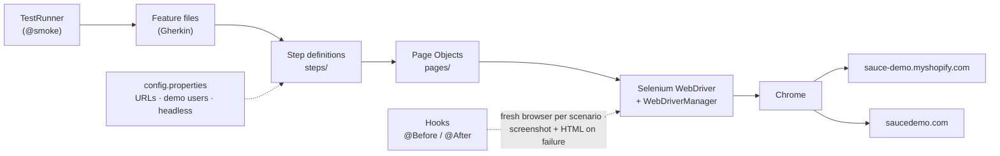

<div align="center">

# 🛍️ Sauce Demo Shop Automation

### BDD UI test suite for the Sauce Demo Shopify store and the Sauce Labs login demo

[](https://git.io/typing-svg)

<!-- ============ STATUS BAR ============ -->
[](https://github.com/rbchy/Sauce-Demo.MyShopify.AutomationTest/actions/workflows/tests.yml)
-22c55e?style=for-the-badge)


</div>

---

## 📌 At a Glance

<table>
<tr>
<td width="50%" valign="top">

**🙋 What this is**

A Cucumber + Selenium smoke suite for two public practice shops:

- 🛍️ **[sauce-demo.myshopify.com](https://sauce-demo.myshopify.com/)** — a Shopify storefront: home page, catalog, blog, About Us, search, product pages and cart
- 🔐 **[saucedemo.com](https://www.saucedemo.com/)** — Sauce Labs' login demo: sign-in, logout and invalid-credential handling

Scenarios are plain-English Gherkin, backed by **Page Object** classes and run by **TestNG** through Maven.

> *A shop that loads but cannot find, show or cart a product is still broken — smoke tests catch that first.*

</td>
<td width="50%" valign="top">

**📍 Quick facts**

| | |
|---|---|
| 🧪 **Scenarios** | 17 in 6 feature files |
| ✅ **CI** | 17 / 17 · headless Chrome · every push |
| 💻 **Local** | 17 / 17 · macOS · OpenJDK 21 |
| 🏷️ **Tags** | `@smoke` (all) · `@Login` · `@regression` |
| 📄 **Report** | [Cucumber report (PDF)](Cucumber.pdf) |

</td>
</tr>
</table>

---

## ✅ Latest Results

Every push runs the whole suite in **GitHub Actions** with headless Chrome ([workflow](.github/workflows/tests.yml)); the report and any failure screenshots are uploaded as a build artifact.

| Feature file | Site | Scenarios | Result |
|---|---|---:|---|
| 🏠 `HomePage.feature` | Shopify store | 1 |  |
| 🧭 `NavigationLinks.feature` | Shopify store | 6 |  |
| 🔎 `SearchFunctionality.feature` | Shopify store | 4 |  |
| 🛒 `AddToCart.feature` | Shopify store | 3 |  |
| 🔐 `LoginSteps.feature` | saucedemo.com | 2 |  |
| 🚫 `InvalidLogin.feature` | saucedemo.com | 1 |  |
| **Total** | | **17** | **100 %** |

<sub>CI: GitHub Actions, Ubuntu, Temurin 17, headless Chrome (32.5 s). Local: [Cucumber.pdf](Cucumber.pdf) — cucumber-jvm 7.18.0, OpenJDK 21.0.7, macOS. Both targets are shared public demos, so results depend on their availability.</sub>

---

## 🎯 Test Coverage

<details open>
<summary><strong>🏠 Home page &amp; 🧭 navigation (Shopify store)</strong></summary>

<br>

- Home page shows the left navigation, featured products, product cards and images, cart and checkout links, and the footer
- **Catalog** opens the collection page · **Blog** opens the blog
- **About Us** opens from both the left navigation and the footer
- **Checkout** link opens the cart · footer **Search** opens the search page

</details>

<details>
<summary><strong>🔎 Search (Shopify store)</strong></summary>

<br>

| Scenario | Check |
|---|---|
| Search bar is visible and accepts input | typed value stays in the field |
| Valid search — *"Noir Jacket"* | results shown, at least one product |
| Invalid search — *"zzqx-no-such-product"* | "no results" message, no products |
| Click the first result | product details page opens |

</details>

<details>
<summary><strong>🛒 Cart (Shopify store)</strong></summary>

<br>

- Cart page loads and shows the empty-cart message
- Product page shows title, price and **Add to Cart**
- Adding a product makes the cart show **1 item**

</details>

<details>
<summary><strong>🔐 Login, logout &amp; invalid credentials (saucedemo.com)</strong></summary>

<br>

- Successful login with the demo user
- Log out from the menu and return to the login page
- Invalid username and password show an error message (`@smoke @regression`)

</details>

---

## 🏗️ Framework Architecture



- **Page Object Model** — `LoginPage` and `InventoryPage` (saucedemo.com) and `SignUpPage` (Shopify registration) keep locators and actions out of the steps
- **Thread-safe driver** — `DriverManager` keeps one `WebDriver` per thread (`ThreadLocal`), ready for parallel scenarios
- **Config, not code** — site URLs and the public demo accounts live in `config.properties`, read by `ConfigReader`; any value can be overridden with `-Dkey=value`
- **Explicit waits** — `WaitUtils` waits for visibility, clickability and for the store's product slide-in animation to finish
- **Failure evidence** — a failed scenario gets a screenshot and the page HTML in the Cucumber report, also saved to `target/screenshots/`
- **WebDriverManager** — downloads the matching ChromeDriver; no manual driver path

---

## 🛠️ Tech Stack

| Layer | Technology | Version |
|---|---|---|
| Language | Java | 17 |
| Browser automation | Selenium WebDriver | 4.x |
| Driver management | WebDriverManager | 5.5.3 |
| BDD | Cucumber JVM (Gherkin) | 7.18.0 |
| Runner | TestNG (`cucumber-testng`) | 7.10.2 |
| Build | Maven (Surefire 3.2.5) | — |
| Reporting | Cucumber HTML + JSON, failure screenshots | — |
| CI | GitHub Actions (headless Chrome) | — |

---

## 📁 Project Structure

```
Sauce-Demo.MyShopify.AutomationTest/
├── src/test/java/
│   ├── base/BaseTest.java              ← compatibility access to the driver
│   ├── hooks/Hooks.java                ← browser per scenario; screenshot + HTML on failure
│   ├── pages/
│   │   ├── LoginPage.java              ← saucedemo.com login
│   │   ├── SignUpPage.java             ← Shopify account-registration form (not yet used)
│   │   └── InventoryPage.java          ← saucedemo.com product list, menu, logout
│   ├── steps/
│   │   ├── HomePageSteps.java          NavigationLinksSteps.java
│   │   ├── SearchSteps.java            AddToCartSteps.java
│   │   ├── LoginSteps.java             LogoutSteps.java
│   │   └── SignUpStep.java             ← Shopify sign-up steps (not used by a scenario yet)
│   ├── runner/TestRunner.java          ← TestNG + CucumberOptions (@smoke)
│   └── utils/
│       ├── DriverManager.java          ← ThreadLocal driver, Chrome options, headless switch
│       ├── ConfigReader.java           ← config.properties + -D overrides
│       └── WaitUtils.java              ← explicit waits, animation wait
├── src/test/resources/
│   ├── config.properties               ← URLs, public demo accounts, headless
│   └── features/                       ← 6 feature files, 17 scenarios
├── .github/workflows/tests.yml         ← runs the suite headless on every push
├── Cucumber.pdf                        ← latest run (17 / 17 passed)
├── pom.xml
└── testng.xml
```

---

## ⚙️ Getting Started

**Prerequisites:** JDK 17+ · Maven 3.8+ · Google Chrome · Git

```bash
git clone https://github.com/rbchy/Sauce-Demo.MyShopify.AutomationTest.git
cd Sauce-Demo.MyShopify.AutomationTest
mvn clean install -DskipTests
```

---

## ▶️ Running the Tests

```bash
# All @smoke scenarios (the runner's default)
mvn clean test

# Through the TestNG suite file
mvn clean test -DsuiteXmlFile=testng.xml

# Headless (what CI runs)
mvn clean test -Dheadless=true

# A single tag expression
mvn clean test -Dcucumber.filter.tags="@Login"
```

**From the IDE:** right-click `runner/TestRunner.java` or `testng.xml` → **Run As › TestNG Test**.

Reports are written after each run to:

| File | Format |
|---|---|
| `target/cucumber-reports/SauceDemoCucumberFinalReport.html` | Cucumber HTML report |
| `target/cucumber-reports/SauceDemoCucumberFinalReport.json` | JSON, for CI plugins |
| `target/screenshots/FAILED_<scenario>.png` / `.html` | Screenshot and page HTML of a failed scenario |

---

## 🧹 Maintenance Log

| Change | Why |
|---|---|
| `pom.xml`: one `selenium-java` and one `cucumber-java`; `cucumber-junit` and JUnit 4 removed | Duplicates let Maven pick versions silently; the runner is TestNG |
| `DriverManager` owns a `ThreadLocal` driver; `Hooks` and `BaseTest` use it | Parallel-safe; no static driver shared between scenarios |
| `config.properties` + `ConfigReader` | URLs and demo accounts out of the step code |
| Screenshot + page HTML on failure; `-Dheadless=true` | Failures explain themselves, in CI too |
| `SignUp.feature` → `InvalidLogin.feature` | The scenario tests an invalid login |
| Wait for the product slide-in animation | Fast headless runs clicked product cards mid-animation |
| Invalid-search term `"Blue Shade"` → `"zzqx-no-such-product"` | The store's fuzzy search now matches *Brown Shades* |

---

## 📈 Roadmap

- [x] Clean `pom.xml`, thread-safe driver, `config.properties`
- [x] Screenshot on failure, headless mode, GitHub Actions
- [ ] saucedemo.com shopping flow: sort, cart badge, checkout, order confirmation
- [ ] A real Shopify sign-up scenario for `SignUpPage` / `SignUpStep`
- [ ] Parallel scenarios (`@DataProvider(parallel = true)`)
- [ ] Allure report published to GitHub Pages

---

## 🔗 Related Projects

| Project | Stack |
|---|---|
| ⭐ [RbcTcsWorld E-Commerce Suite](https://github.com/rbchy/RbcTcsWorld_ECommerceSuite) | Spring Boot · REST Assured · Selenium · Playwright · CI quality gates |
| 🔌 [API — Rest Assured](https://github.com/rbchy/QaBrainsAPIAutomationRestAssured) | Java · Rest Assured · Cucumber · Selenium — CI green |
| ☁️ [Sauce Labs Cloud Automation](https://github.com/rbchy/QaBrainsSauceLabAPI_Automation) | Java · Selenium · Cucumber · Sauce Labs |
| 🏥 [OpenEMR Healthcare](https://github.com/rbchy/OpenEMR_Automation) | Java · Selenium · Cucumber · TestNG |

<sub>All projects: [github.com/rbchy](https://github.com/rbchy)</sub>

---

## 👤 Author

<div align="center">

**Ranajit Baran Chowdhury (RB Chowdhury)**
QA Automation Engineer / SDET · West Norriton, Pennsylvania, USA

[](https://www.linkedin.com/in/rbchy/)
[](https://github.com/rbchy)
[](https://rbchy.github.io/rbchy/)
[](https://rbc6543.wixsite.com/rbc-portfolio)
[](mailto:chyranajit@gmail.com)

<sub>Provided for educational and professional QA automation purposes. Both target sites are public practice demos.</sub>

⭐ *If this project helps you, a star on the repo is appreciated.*

</div>
